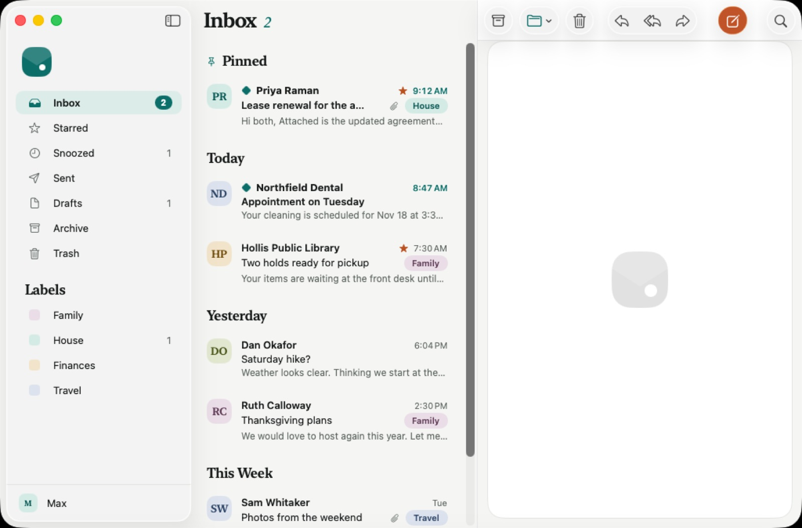
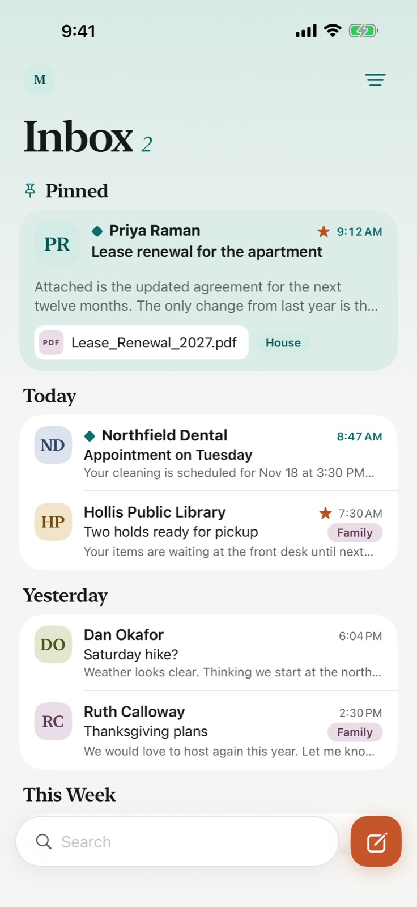
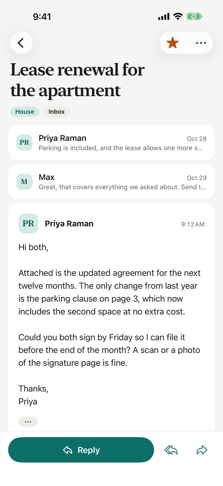
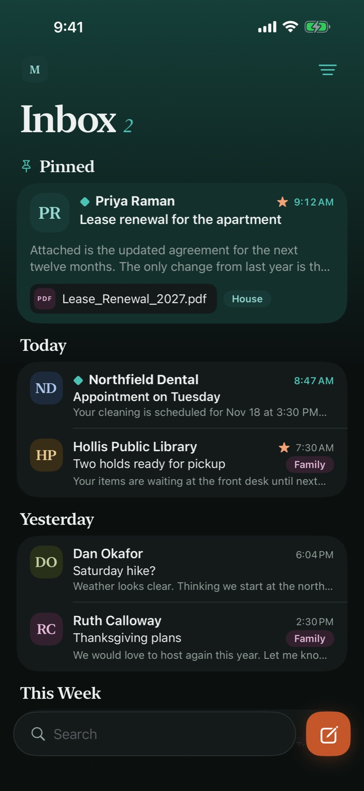
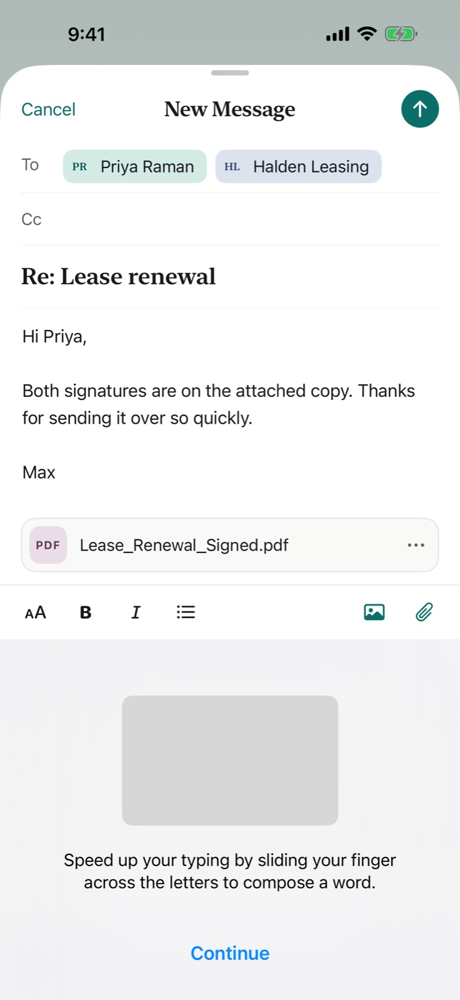

<p align="center"></p>

<h1 align="center">Quill</h1>

<p align="center">A native Gmail client for iPhone, iPad and Mac, built with SwiftUI.</p>

<p align="center">
  <a href="https://github.com/MaxiG0D/quill/releases/latest"><b>Download for Mac</b></a>
  &nbsp;·&nbsp; macOS 26 &nbsp;·&nbsp; MIT
</p>

<p align="center"></p>

<p align="center">
  
  
  
  
</p>

## Features

- Gmail sign-in with PKCE; the token stays in the keychain
- Inbox, Starred, Snoozed, Sent, Drafts, Archive, Trash and labels, all read and filed through Gmail
- Pinned threads and snooze
- Sender pictures from your Google contacts, then the site's logo, then initials
- Instant new-mail notifications and an unread badge, through a small push relay
- Offline reading from a local cache
- Light and dark appearance, seven app icons
- Mac updates itself with Sparkle

## Install

Download `Quill-<version>.zip` from the [latest release](https://github.com/MaxiG0D/quill/releases/latest), unzip it and move Quill to Applications. The build is signed and notarized. Later versions arrive from Quill, Check for Updates….

iPhone and iPad: build from source.

## Build from source

Xcode 26 or later; the app targets iOS 26 and macOS 26.

```sh
git clone https://github.com/MaxiG0D/quill.git
open quill/Quill.xcodeproj
```

Run the `Quill` scheme on a simulator, a device or My Mac. Without a Google client ID the app opens a sample mailbox. To sign in to Gmail, add your own client ID as described below.

## License

[MIT](LICENSE)

---

# Development

## Gmail

1. In [Google Cloud Console](https://console.cloud.google.com/apis/credentials), create a
   project and enable the Gmail API and the People API.
2. Configure the OAuth consent screen, and add your own Google account as a test user.
3. Create an OAuth client of type iOS with the bundle ID `com.maxig0d.quill`.
4. Paste its client ID into `App/Configuration.swift`.

The same client serves iPhone, iPad and Mac. Sign-in uses the system web sign-in sheet with
PKCE, and the token is kept in the keychain. Quill asks for the `gmail.modify` scope, which
covers reading, filing and sending, and for read-only access to contacts, which gives senders
their pictures.

A sender's picture (`Core/Pictures`) is the person's own from the account's Google contacts,
or else the logo of the site the mail came from, and their initials when there is neither.

Mail access goes through the `MailService` protocol. `GmailMailService` lists the Inbox, Starred, Drafts, Trash and the newest
100 threads, fetches only those whose history ID changed since the last refresh (40 per pass, to stay inside Gmail's 6,000 quota units a minute), and keeps
the result in `Application Support/Quill/mailbox.json` so the app opens at once and reads
offline. Archive, Trash, star and unread are written back to Gmail. Pins and snoozes have
no Gmail equivalent, so they stay on the device. `SampleMailService` remains for previews,
tests and screenshots.

New mail is announced with a local notification and the unread count sits on the app's icon
(`Core/Notifications`). `MailNotifier` takes in every refreshed mailbox, and `NewMailLedger`
makes sure a message is announced once and that nothing from before the first refresh is.
Quill refreshes every minute while it runs, and on iPhone and iPad the system's background
app refresh (`BackgroundRefresh`) gives it a turn while it is closed. Tapping a notification
opens its thread (`NotificationTaps`).

## Mac updates

The Mac app updates itself with [Sparkle](https://sparkle-project.org) (Quill menu, Check for
Updates…). It reads `appcast.xml` from the latest GitHub release, so the repository has to be
public for installed copies to see it. Updates are signed with an EdDSA key that lives only in
the Keychain of the Mac that releases.

1. `xcrun notarytool store-credentials quill-notary`, once.
2. `Scripts/release-mac.sh setup`, once. Commit the public key it writes to `App/Info.plist`.
3. `Scripts/release-mac.sh 0.2.0` for each release.

## Push

`Relay/` is a small Node service for Google Cloud Run that makes notifications instant. Gmail
publishes each mailbox change to a Pub/Sub topic (`users.watch`), Pub/Sub delivers it to the
relay, and the relay reads what arrived and sends each of the account's devices a notification
through Apple's push service.

| Path | Contents |
| --- | --- |
| `Relay/src/server.js` | The three routes: `POST` and `DELETE /devices` for Quill, `POST /gmail` for Pub/Sub. |
| `Relay/src/relay.js` | Registration, the Gmail watch and its renewal, and turning a change into notifications. |
| `Relay/src/newMail.js` | Which messages earn a notification, and its payload. |
| `Relay/src/google.js`, `apns.js`, `accounts.js` | Gmail and OAuth calls, Apple's push service, and the Firestore record per account. |
| `Relay/deploy.sh` | Creates everything in Google Cloud and deploys. Safe to run again. |

To read the mailbox the relay keeps the account's refresh token in Firestore, in the same
Google Cloud project as the OAuth client. A device registers with a Google access token, and
the relay only accepts tokens issued to Quill's own client ID. The push key lives in Secret
Manager and never in the repository.

```sh
Relay/deploy.sh ~/Developer/quill-secrets/AuthKey_<key ID>.p8   # prints the relay's URL
cd Relay && npm test
```

Paste the URL into `pushRelayURL` in `App/Configuration.swift`. On each launch Quill registers
the device (`PushRelay`, `PushDevice`, `QuillAppDelegate`), and from then on the relay sends the
notifications while `MailNotifier` keeps the badge and delivered notifications in step. With
the URL empty, or when the relay cannot be reached, Quill announces new mail itself as above.
Turning off New Mail in Settings, or signing out, removes the device from the relay.

Not built yet: sending attachments, saving drafts to Gmail, downloading attachments,
images embedded inside a message, and more than the newest 100 threads outside search.

## Layout

| Path | Contents |
| --- | --- |
| `App/` | The app target: the entry point, icon and entitlements. |
| `QuillKit/Sources/QuillKit/Core/` | Models, sectioning, search, `MailStore`, Google sign-in (`Google/`) and the Gmail client (`Gmail/`). No SwiftUI. |
| `QuillKit/Sources/QuillKit/Design/` | Design tokens: colors, type roles, spacing, radius and motion. |
| `QuillKit/Sources/QuillKit/Components/` | Reusable views such as `MailRow`, `PinnedCard` and `MonogramAvatar`. |
| `QuillKit/Sources/QuillKit/Features/` | Screens, grouped by feature. `Root/` chooses the phone or wide layout. |
| `QuillKit/Tests/` | Unit tests for the models, logic and store. |
| `UITests/` | Navigation tests, and screenshot tests for each mockup screen. |
| `Screenshots/` | The latest screenshot of each screen, written by CI. |
| `Design/Icon/` | `icons.json` holds each icon's colors. `node Scripts/render-icons.cjs` draws the app icon sets and the picker's previews from it. |

The Xcode project uses synchronized folders, so new files appear in the project as soon
as they are added on disk. One type per file.

## Design tokens

Every color, type role, spacing step and radius comes from the Tokens page of the mockups
and lives in `Design/`. Views use `Palette`, `Spacing`, `Radius`, `Motion` and
`.textRole(_:)` instead of literal values.

## Testing

```sh
xcodebuild test -project Quill.xcodeproj -scheme Quill -destination 'platform=iOS Simulator,name=iPhone 17 Pro'
xcodebuild test -project Quill.xcodeproj -scheme Quill -destination 'platform=macOS'
```

The screenshot tests launch the app with `-QuillScreen <inbox|thread|search|compose|mailboxes|settings|zero>`
and `-QuillAppearance <light|dark>`, which loads the mockup's mailbox frozen at the moment
the mockups show. CI runs everything on each push and commits the latest screenshots to
`Screenshots/` on the branch, so a pull request shows what changed visually.
